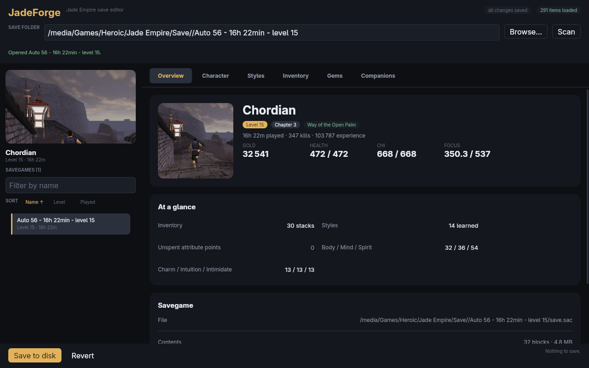
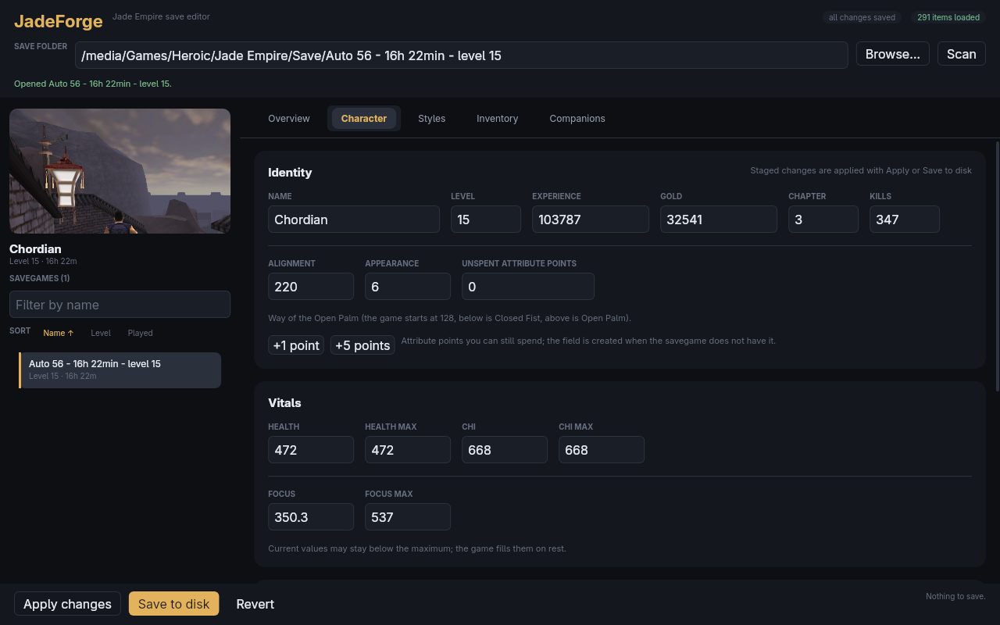
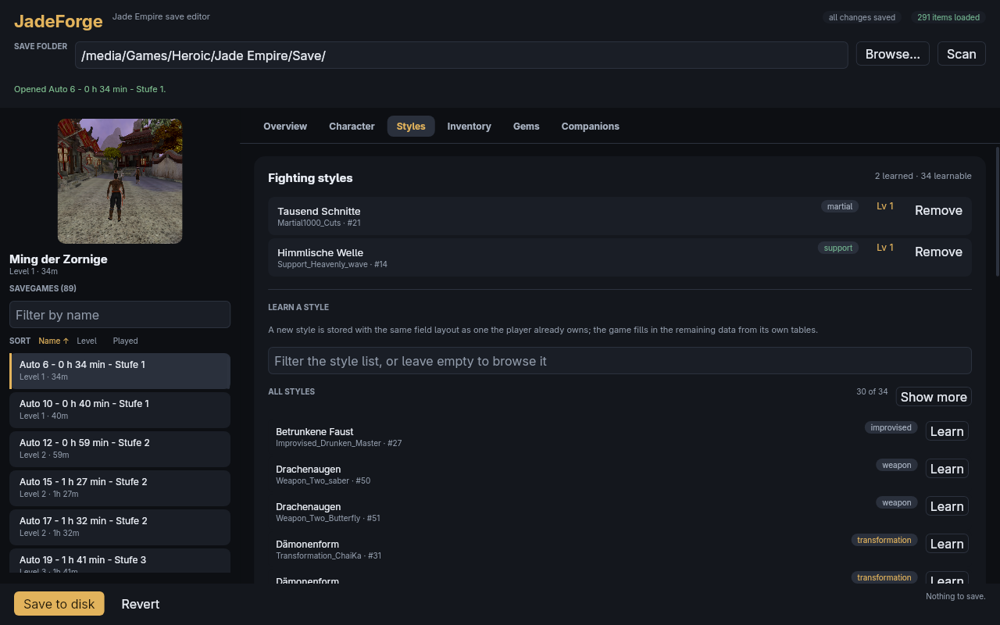

# JadeForge

A savegame editor for **Jade Empire** for Linux, Windows and macOS.



JadeForge reads and writes `save.sac` files directly and uses the game's own
data files to show real item, style and location names. It never needs a running
game, never installs hooks and never modifies game files: it edits the same data
the game does, verifies the result and keeps a backup of the original.

## Features

- **Character editing** – name, level, experience, gold, unspent attribute
  points, health, chi and focus (current and maximum), body/mind/spirit,
  charm/intuition/intimidate, alignment (with the game's Closed Fist / Open
  Palm label), appearance, chapter and kill counter.
- **Fighting styles** – every learned style with its localized name, kind
  (martial, weapon, magic, support, transformation, improvised, unique) and
  level. Expanding a style shows its description and the actual upgrades behind
  the level: one plain golden orb per tier and family (no numbers: the left-to-right order is the tier) (damage, chi strike, speed, chi cost,
  duration, ...), each one a row of `StyleAdvance.2da` with its own cost. The
  level is read-only and follows `1 + number of owned upgrades`, exactly like the
  game stores it. Clicking an orb buys every missing tier up to it, clicking an
  owned orb removes it together with everything above it, so `1 -> 4` and
  `5 -> 0` are one click and a family is always a gap-free prefix. The orbs come
  from the style's own `<Style>LV.2da` table, read from the shipped
  `data/miniglobal-a.rim` archive through `styledata.2da`; styles without a
  table are read-only instead of guessing. All learnable styles are listed for
  browsing, with a filter for searching, and styles can be learned and removed.
- **Inventory** – every stack with its real name and category resolved from
  `items.2da` and `dialog.tlk`. Stack sizes can be changed, items removed, and
  new items can be added from the game's item database, which is browsable in
  full and searchable by name or template. Rows always show the same
  `category · #id` (items) and `template · #id` (styles) subtitle. Click a row
  to expand the game's own description.
- **Companions** – all party members with their level and availability, editable.
- **Gems** – amulet sockets and carried gems with their actual effect lines
  (for example `+4 Body · +4 Spirit`). A gem can be moved between the two lists
  or removed without touching its effects. The amulet's tier and socket count
  are shown (`Amulet.Type`: 3, 5 or 7 sockets; before the amulet is unlocked the
  tab says so), locked sockets are hidden, empty unlocked sockets are shown as
  such, and the predefined gems from `gems.2da`
  can be added to the inventory through a searchable list.
- **Savegame browser** – scans the save folder and shows the game's own
  screenshot, character name, level and play time for every savegame. The list
  can be filtered by name and sorted by name, level or play time, with natural
  ordering (`Auto 2` before `Auto 10`).
- **Native folder dialog** – **Browse…** opens the operating system's own folder
  dialog (GTK/XDG portal on Linux, Win32 on Windows, `NSOpenPanel` on macOS), so
  the save folder never has to be typed. The choice is remembered between runs
  and no installation path is baked into the program.
- **Responsive layout** – the sidebar, tab bar and stat rows adapt down to small
  windows instead of clipping.
- **Native icon** – the hammer-and-jade mark is embedded in the window and in
  the Windows executable, staged as a macOS `.app` bundle, and installed with
  the launcher entry and hicolor icons on Linux.
- **Safe by design** – every write is verified by re-parsing the produced file,
  written atomically through an exclusive temporary file, and guarded by a
  unique backup. The original permissions are kept, a savegame that changed on
  disk is reported instead of overwritten, and saving through a symlink keeps
  the link.
- **Byte exact when untouched** – opening and saving without changes produces
  the identical file, because only edited blocks are re-serialized.
- **Command line tool** for scripting, bulk inspection and debugging.





## Requirements

- Rust 1.88 or newer to build from source.
- Linux: an X11 or Wayland session with OpenGL 3.3 (or the equivalent on
  macOS/Windows) and, for the native folder dialog, `xdg-desktop-portal`
  (installed by default on GNOME, KDE and most desktops). The GUI is a native
  window, there is no browser or Electron layer.

## Building

```sh
cargo build --release
```

The binaries are then at:

- `target/release/jadeforge` – desktop application
- `target/release/jadeforge-cli` – command line tool

Run them directly:

```sh
./target/release/jadeforge
```

or start the CLI against a save folder:

```sh
./target/release/jadeforge-cli info "/path/to/Jade Empire/Save/Auto 56 - 16h 22min - level 15"
```

### Distribution builds

`just publish` builds both binaries with the `dist` profile — release
optimisation with fat LTO — and stages them in
`dist/jadeforge-<version>-<target>/` with the licence, README and the
platform's icon files.

The Linux binaries inside that folder have to be built against an older glibc
than current distributions ship, otherwise they refuse to start on SteamOS /
Steam Deck (`GLIBC_2.44 not found`). `just publish-linux` does that in a rootless
Podman container based on Ubuntu 22.04 (glibc 2.35), stages
`jadeforge` + `jadeforge-cli` into `dist/` and verifies the result with
`ci/check-glibc.sh`:

```sh
just publish-linux
```

It needs `podman` (`sudo apt install podman`) and the first run builds the image
in `ci/Containerfile`; later runs reuse the cached layers and the
`target/podman` build cache.

Linux and Windows x86-64 releases contain two GUI binaries and two CLI binaries:

| binary | ISA | CPUs |
| --- | --- | --- |
| `jadeforge`, `jadeforge-cli` | **x86-64-v3** (AVX2, FMA, BMI2) | Haswell (2013+), Steam Deck Zen 2 |
| `jadeforge-generic-cpu`, `jadeforge-cli-generic-cpu` | baseline | every x86-64 CPU |

The fallback is built and staged automatically, so users on pre-2013 CPUs run
the `jadeforge-generic-cpu` binary and everyone else gets the faster default. macOS builds
once in baseline mode for both architectures: the Intel binary must also run
under Rosetta, which has no AVX2. Run it on
each platform you want to ship:

| host | targets |
| --- | --- |
| Linux | the native target |
| macOS | `aarch64-apple-darwin` and `x86_64-apple-darwin` |
| Windows | the native MSVC target |

Windows and macOS binaries have to be built on their own OS: the Freya GUI links
prebuilt Skia libraries, and Windows additionally needs Visual C++ while macOS
needs the Apple SDK. The command skips those targets elsewhere with a notice.
`just publish-target <triple>` builds and stages a single target, for example
`aarch64-unknown-linux-gnu` when an ARM64 cross compiler is installed.

A local macOS build (`just publish` on a Mac) stages `JadeForge.app` next to the
bare binaries; the bundle carries the `.icns` so Finder and the Dock show the
icon. Windows executables embed the `.ico`. Linux folders contain
`share/applications/jadeforge.desktop` and `share/icons/hicolor/...`; install
the CPU-appropriate binary as `jadeforge` in a directory on `PATH`, then copy
`share/` into `~/.local/share` so Wayland launchers resolve the icon.

The [CI workflow](.github/workflows/ci.yml) runs `just publish` on Linux and
Windows, stages third-party notices, an SBOM and build provenance, and uploads
the staged folders as per-OS artifacts; pull requests skip that job. On a `v*`
tag the `release` job zips each platform folder, writes one `SHA256SUMS`, and
creates the GitHub release from the matching changelog section. macOS is not in
the release matrix yet, because the bundle has to be signed and notarised
first, and the published binaries are unsigned for now, so Windows SmartScreen
warns about an unknown publisher.

The `just` shortcuts are optional; the cargo commands above remain the
canonical ones. `just check` runs the formatting, clippy and test gate,
`just setup`/`just start`/`just finish` manage task branches, and `just
coverage` writes a line/function summary plus HTML and lcov reports to
`coverage/`.

## Using the desktop application

1. Start `jadeforge`.
2. Pick your Jade Empire `Save` folder with **Browse…** (the native dialog, or
   type the path) and
   press **Scan**. JadeForge has no built-in guess where the game is installed:
   GOG, Steam, Heroic, Wine and manual installs all differ, so the folder is
   chosen once and remembered in the user configuration, a small TOML file
   (`$XDG_CONFIG_HOME/jadeforge/config`, `%APPDATA%\jadeforge\config` or
   `~/Library/Application Support/jadeforge/config`). `JADEFORGE_SAVE_DIR`
   overrides the folder for one run and `JADEFORGE_CONFIG_DIR` moves the
   settings file (useful for portable installs).
3. Pick a savegame on the left; the game's own screenshot and character summary
   appear above the list. The list can be sorted by name, level or play time,
   and that choice (like the save folder) is remembered for the next start.
4. Edit the values on the tabs. Every change — text fields, items, styles,
   gems and companions — is applied to the in-memory savegame immediately; the
   header shows "unsaved changes" and switching away is blocked until you save
   or revert. A field with invalid text is reported and not applied until it is
   fixed.
5. Press **Save to disk**. A backup called
   `save.sac.jadeforge-backup-<seconds>.<nanos>.<counter>` is created next to
   the savegame; copy it back over `save.sac` to undo a change. Repeated saves
   never overwrite an earlier backup.

## Game data

Names are not stored in savegames, they are talk table references in 2DA tables.
JadeForge looks for the game installation next to the save folder (the parent of
`Save/`, or `Save/<savegame>` when a savegame folder is selected). The
`JADEFORGE_GAME_DIR` override wins; if it is unset or does not point at an
installation, the normal layout is used. It reads only:

| file | used for |
| --- | --- |
| `dialog.tlk` | every localized name and description |
| `override/items.2da` | item names, categories, icons |
| `override/stylesuperlist.2da` | fighting style names and weapon data |

Most tables are not loose files at all: they ship as binary `2DA V2.b` resources
inside `data/miniglobal-a.rim`, and the editor reads them from there (for
example `styledata.2da`, which maps every style to its own level-up table).
Files in `override/` take precedence over the archive exactly like the engine
does, so **mods that add styles or change tables are picked up**: extend
`stylesuperlist.2da`, add a `styledata.2da` row pointing at the new
`<Style>LV.2da`, and the editor resolves the modded upgrades like the shipped
ones. Override files are read case-insensitively and tolerate non-UTF-8 text.

Set `JADEFORGE_GAME_DIR` to point at an installation somewhere else. When the
files are missing the editor still works, it just shows numeric ids instead of
names. Nothing in the game folder is ever written.

## Using the command line tool

```sh
jadeforge-cli [SAVE] <COMMAND>

Commands:
  info                      Print a summary of a savegame
  blocks                    List the blocks stored in a savegame
  character                 Print the player character
  items                     Print the player inventory (with names)
  styles                    Print the player's fighting styles
  companions                Print the player's companions
  get    <BLOCK> <PATH>     Print a field
  set    <BLOCK> <PATH> <VALUE> [--dry-run] [--no-backup]
  dump   [BLOCK] [--path] [--json]   Dump a block as JSON
  verify                    Verify that a savegame can be parsed and written
  add-item <ITEM_ID> [--kind 6] [--count 1] [--dry-run]
```

`SAVE` may be the savegame file itself or the folder that contains it.
`dump` always emits JSON; `--json` is accepted for scripts that spell it out.
`set` is the raw debugging escape hatch: unlike the desktop editor it does not
range check known character fields.

Examples:

```sh
# Show the character of one savegame
jadeforge-cli "/path/to/Save/Auto 56 - 16h 22min - level 15" info

# Show the learned styles and the inventory with names
jadeforge-cli save.sac styles
jadeforge-cli save.sac items

# Give the character gold
jadeforge-cli save.sac set save.sav PlayerCreature.Stats.Gold 999999

# Inspect the raw structure
jadeforge-cli save.sac dump save.sav --path PlayerCreature.Stats

# Verify a savegame without touching it
jadeforge-cli save.sac verify
```

## Where are my savegames?

Jade Empire keeps its savegames in a folder called `Save` next to the game
executable (`dialog.tlk`, `override/`). Where that folder is depends on how the
game was installed, so JadeForge asks for it once instead of guessing:

- GOG: the folder the GOG installer created, usually below `Galaxy/Games` or
  your library drive.
- Steam or Heroic: the prefix/library folder you installed it into.
- Wine/Proton: the prefix's `drive_c` path.

Any folder works as long as it contains one sub-folder per savegame with a
`save.sac` inside. Use **Browse…** in the application (the system's folder
dialog), or set `JADEFORGE_SAVE_DIR` for scripts and CI.

## How it works

The savegame format is documented in [docs/FORMAT.md](docs/FORMAT.md) and the
internals in [docs/ARCHITECTURE.md](docs/ARCHITECTURE.md). In short: a
`save.sac` is a container of named, self describing blocks; the editor decodes
the block holding the player, changes only the fields that differ, verifies the
result and writes it back.

## Development

Work happens on task branches; `main` only receives merged branches. Install the
tracked hooks once per clone and start every task from the latest `origin/main`:

```sh
just setup
just start fix/save-load    # <type>/<slug>
# ... work ...
just finish                 # fails on main, a dirty tree or no commits
```

```sh
cargo install cargo-nextest --locked   # once; the test runner
cargo nextest run --workspace          # unit, synthetic, real savegame and headless UI tests
cargo test --workspace --doc           # doctests, which nextest does not run
cargo clippy --workspace --all-targets -- -D warnings
cargo fmt --all --check
just live                              # windowed UI tests; ask first (rule 13)
```

A branch is ready for review only when the worktree is clean and `just finish`
passes; see [CONTRIBUTING.md](CONTRIBUTING.md) for the full checklist.

To install only the GUI binary into `~/.cargo/bin` (which must be on `PATH`),
tuned for the current machine's CPU:

```sh
just install
```

This uses `-C target-cpu=native`, so the resulting binary can use every CPU
feature the build host has; it is not portable to other machines. Use
`just publish` / `just publish-linux` for distribution binaries. Skia is still
the prebuilt library, so only the Rust code gets native code generation.

On Linux, `just install-desktop` installs everything in one step: the GUI
binary, the desktop entry and the hicolor icons. The launcher and Wayland
compositors can then resolve the icon by app id:

```sh
just install-desktop
```

The launcher entry expects `jadeforge` on `PATH` (the location `just install`
uses). The icon master lives in `crates/jadeforge-gui/assets/icon.svg`;
`just icons` regenerates the PNG, ICO and ICNS files from it (needs
`rsvg-convert`, ImageMagick and Python 3).

Tests that need real savegames or the game data are skipped unless the files are
available:

```sh
JADEFORGE_SAVE_DIR="/path/to/Jade Empire/Save" cargo nextest run --workspace
```

The headless UI tests render the real component tree with `freya-testing` and
build a synthetic savegame plus installation when no game data is present, so
they work on CI machines without a display or the retail game.

The windowed suite is the second feedback loop: it launches the real application
through `freya-winit`, opens a real Wayland window and drives it with real
compositor input on KDE (or with events through the windowed plugin handle on
other compositors). It is opt-in with `just live`, so normal test runs never open
windows. Run it from a real Wayland desktop session, or from a VM with a real
desktop; it is not part of CI. **Never run it without explicit permission**
([AGENTS.md](AGENTS.md) rule 13), and only when a headless test cannot cover the
case or the bug is in the real window. See
[docs/LIVE-UI.md](docs/LIVE-UI.md) for the backends, the process model and how to
add a scenario. The active workflow is
[`.github/workflows/ci.yml`](.github/workflows/ci.yml); see
[ci/README.md](ci/README.md) for its jobs and the release signing checklist.

See [AGENTS.md](AGENTS.md) for the development guidelines,
[CONTRIBUTING.md](CONTRIBUTING.md) for the review checklist,
[SECURITY.md](SECURITY.md) for vulnerability reporting and
[docs/ARCHITECTURE.md](docs/ARCHITECTURE.md) for the crate layout. User-visible
changes are listed in [CHANGELOG.md](CHANGELOG.md).

## Status

The format reader/writer is validated against 89 retail savegames (962 blocks):
every block parses, every block survives a serialize/parse round trip, and
untouched savegames are written back byte for byte.

Not implemented yet:

- editing story variables and journal entries,
- companion stats beyond level and availability,
- item icons in the interface (names, categories and descriptions are resolved
  and shown).

## License

MIT
