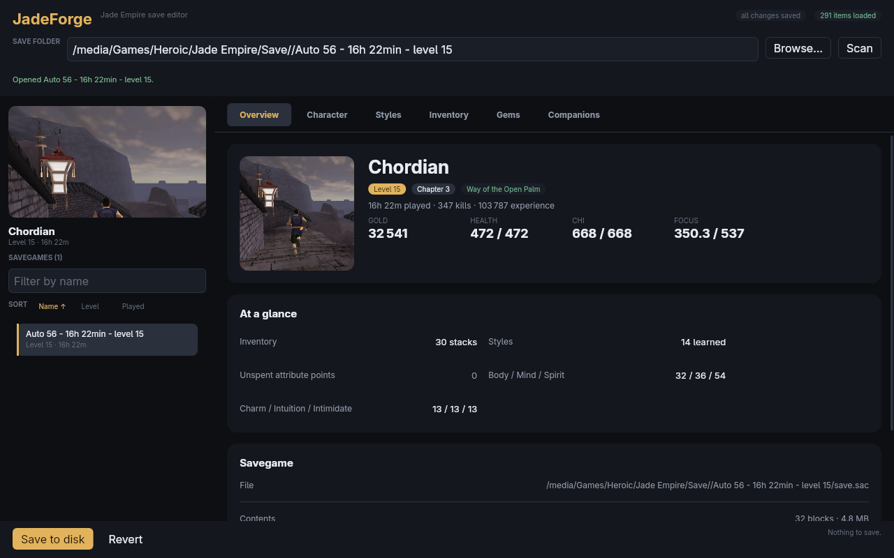

# Desktop UI review: status and remaining work

**Reviewed:** 2026-11-05, P1 follow-up 2026-11-06 · **Base:** `main` at `6e1d4b8`
**Scope:** the Freya 0.5 desktop UI in `crates/jadeforge-gui`, the session state it renders, and the real 89-savegame corpus.
**Status:** P0 release blockers are addressed and the P1 follow-ups are implemented on `fix/ui-p1-followups`, with the verification gaps listed under P1. P2/P3 work is tracked in GitHub issues; the remaining upstream blocker is the missing `Input` label association.

## What the review covered

The review read the GUI, session and theme code, ran the headless UI suite and rendered all six tabs at 900×700, 1180×760, 1280×900 and 1600×900, plus expanded, empty, Gold-less and invalid-form states. The real window was inspected over AT-SPI, and the windowed suite was run with real KWin input, including a keyboard-navigation scenario.

The strongest parts of the current UI are the coherent jade-on-charcoal palette, the save-safety pipeline (verification, atomic write, backups and close guard), the fixed preview square, and the layout-shift/geometry tests. The main remaining work is responsive composition, state handling around save/folder changes, discoverability of expansion/upgrades, and accessibility outside the app's control.

## P0: addressed

| Item | Result |
| --- | --- |
| Gold-less saves opened as `invalid character input` | Fixed: a missing `Stats.Gold` stays absent; a UI regression removes the field from the fixture. |
| Save browser showed two rows at the supported minimum | Supported minimum is now **900×700** and the preview is **120×120**; at least four rows fit and this is tested. |
| Revert and destructive removes were one click | Revert, Remove item/style/gem now confirm; the last style cannot be removed because it is the layout template for learning another. |
| Screen reader could not read the page | Static text, headings, status live region, tab/list roles and states, expanded/owned states and a single-tab-stop save list are exposed. Headless a11y tests cover the tree. |
| Baseline CI failed on every PR | Separate fix: macOS non-UTF-8 fixture skip, Windows `sync_parent` lint, fixed sort-arrow slot, and Windows `RUSTDOCFLAGS` environment. |

Merged in [#5](https://github.com/mztikk/jade_empire_save_editor/pull/5) and the baseline fix in [#6](https://github.com/mztikk/jade_empire_save_editor/pull/6).

App-side accessibility is in place, but **full screen-reader operation is still blocked upstream**; see the open issues below.

## Remaining work

The GitHub issues are the source of truth for checklists. This section is a short map.

### P1: [#7](https://github.com/mztikk/jade_empire_save_editor/issues/7)

Addressed on the `fix/ui-p1-followups` branch:

| Area | Result |
| --- | --- |
| Responsive composition | Fluid 3+3 identity grid at 1180×760 and 900×700, overview glance cells 1-up → 2+2+1, hero stats 2×2, 1100 px editor cap and a 720 px text measure; descriptions expand in full. |
| Window geometry | `geometry::fit_window` clamps the default and remembered size to the monitor, lowers the minimum on short screens and keeps a stored position on screen; a plugin remembers the rectangle. Tested for 1366×768 at 125 %. |
| Clipped names | Ellipsis plus a tooltip on save, item, companion and sidebar names; the overview path wraps and has a Copy path action. |
| State safety | Scan keeps the open savegame for the same folder and re-locates it by path; Browse checks dirty state before the dialog; filters, paging, expanded rows and scroll positions reset on a document change; every filter has a Clear button. |
| Save vs. form | Each field validates on its own and shows its range; valid fields apply even when another is invalid; Save writes applied edits, reports the invalid form separately and focuses the first invalid field. |
| Dirty state | Content comparison against canonical block payloads: edit-then-restore clears the flag. |
| No-save and feedback | Tabs and Save/Revert are disabled without a savegame and the empty state has a primary folder action; status is a persistent three-line, copyable slot with a success glyph; unreadable sections are not shown as empty lists; folder and game-installation errors are distinct. |
| Discoverability | Chevron/Details rows, orb hover and focus details with the buy/remove explanation, a read-only style notice, gem effect lines in the picker. |
| Editing UX | Contextual accessible names, Ctrl+S/O/F, F5, Enter, Escape and tab arrow keys, direct numeric stack/level editing, character name and UTC modification time in save rows. |
| Accessibility | 28 px row targets, 11 px micro / 14 px body type, 3:1 control borders, tab underline, amber unsaved state, focus restoration after a removal, focusable keyboard scroll view. |
| Performance | Manual Scan (startup, button, Enter, F5 and Browse) runs on a worker with an in-flight status and cancellation; save filter/sort, item suggestions, learnable styles and the form reparse are memoised; save rows keep stable `Action` objects and paint hover without a rebuild; frame-time instrumentation and an 89-save render test. |

Still open for #7:

- `just live` passed all five windowed scenarios, so real window creation,
  presentation, pointer input and keyboard navigation are verified. There is
  no live scenario that closes and reopens the window to observe the stored
  rectangle, and the scroll-view paging keys only have their focus target
  asserted, so the remembered geometry and the real scroll offset remain
  unverified.
- The status live region still needs a screen-reader pass with Orca or NVDA
  (neither is installed on the review machine).

### P2: [#8](https://github.com/mztikk/jade_empire_save_editor/issues/8)

Polish after P1:

- Copy and vocabulary: the empty carried-gems hint can read “1 gem”, `ALL STYLES` lists only unlearned styles, `Level`/`Lv`, `Played`, raw categories and `predefined gems` need a pass.
- Backup discovery/restore, a three-way close dialog, disabled/no-op Save and Revert states.
- Visual polish: duplicate Overview screenshot, sidebar alignment, preview radius, full-width Overview values, open-folder action, loading states.
- Guidance/settings: About/version/help, config location, field ranges/units, item category filtering, save-filter placeholder.
- Tooling/docs: snapshot `--query` targets the first filter (the save filter) instead of the active tab’s filter; document evidence/screenshot maintenance.

### P3: [#9](https://github.com/mztikk/jade_empire_save_editor/issues/9)

Strategic work:

- Light/system theme, high-contrast support, text scaling/zoom, UI localization.
- Virtualized large lists, full undo/redo, pending-changes diff, backup restore screen, external-change reload.
- Item/style icons, About/help, command palette/cheat sheet, configurable window geometry and multi-monitor policy.

## Upstream accessibility blockers

These are not fixable from this repository alone.

Freya 0.5 resolved two of the three blockers: an element with `on_press` now
registers the AccessKit `Click` action and handles the action request, label
and paragraph values are filled while the accessibility tree is built, and
accessibility nodes are refreshed when their diff says so. The headless suite
activates a tab through a synthetic AccessKit `Click` and asserts that dynamic
label text reaches the effective AccessKit node. The remaining blocker is
tracked as an open issue:

| Issue | Blocker |
| --- | --- |
| [#3](https://github.com/mztikk/jade_empire_save_editor/issues/3) | `Input` has no label/labelled-by API; fields are still named by their current value or placeholder, even though captions are exposed as groups. |

## Verification

- `just check`: 396 workspace tests passed (1 skipped: the opt-in live suite), clippy and formatting clean after the P1 work (see `docs/COVERAGE.md` for coverage).
- Headless coverage of the P1 work: geometry at 1180x760, 900x700 and 1600x900; DPI geometry for 1366x768 at 125 %; scan-keeps-save; dirty content comparison; invalid-form save independence; first-invalid-field focus; focus restoration after removal; target sizes; keyboard scrolling focus; the 89-save render test.
- `just live`: all five windowed scenarios passed on Wayland with the KWin input backend at 1180x760. The window opened at the configured size, save opening and tab switching, item filtering, keyboard save-list navigation and real frame presentation all worked; the captured frame was written to the ignored `target/live-ui/presented.png`. Every scenario used its own settings directory.
- Live AT-SPI check: static text, count, status, tab selected state and the focusable save list box were current; the desktop accessibility setting was restored afterwards. This was the P0 review; the P1 status live region has not been re-validated with a screen reader.
- The P0 work is merged on `main`; the remaining P1 items and #8/#9 are tracked in the issues above.

## Notes

- The review was performed against `main` at `aecc57a` and re-verified after the P0 merge at `9151c2a`.
- The local evidence images and the longer working report were kept outside the repository (ignored `scratch/`); this file and the linked issues are the durable record.
